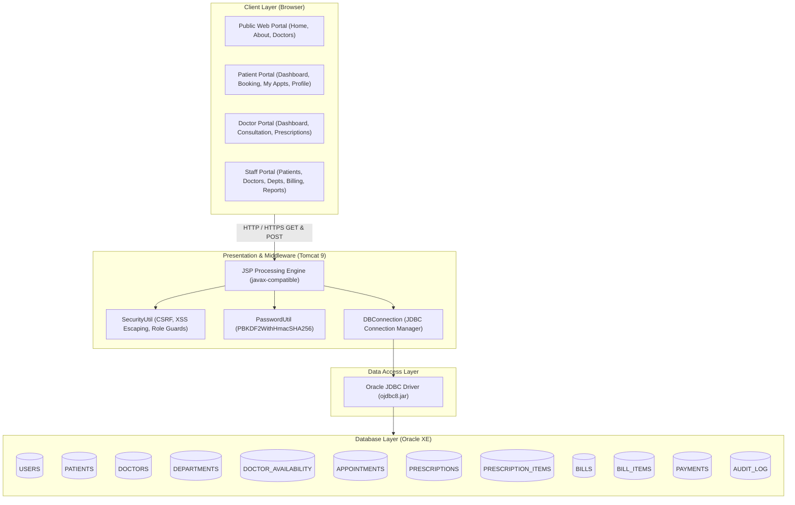
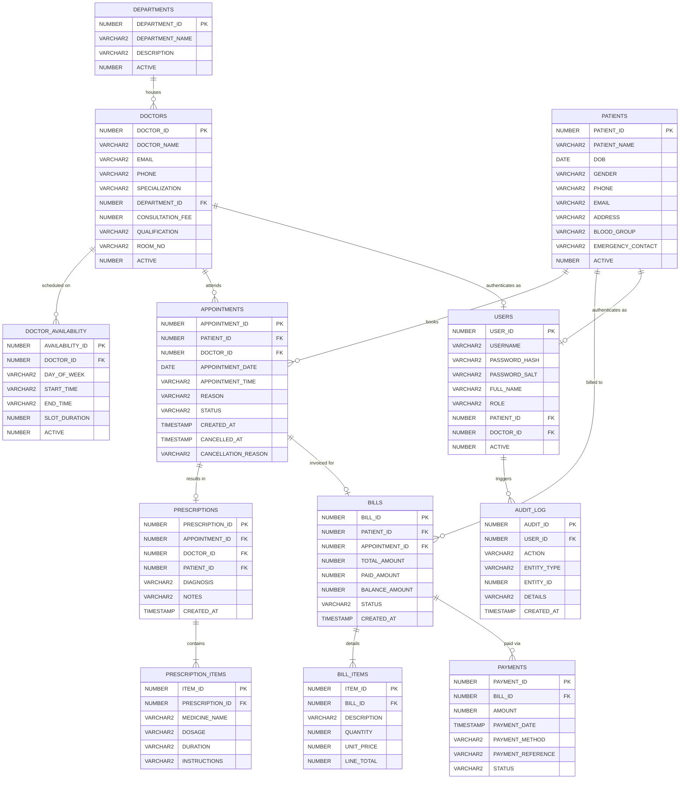

# Hospital Management System (HMS) - System Architecture & Database Design

## 1. System Overview

The **CityHealth Hospital Management System (HMS)** is built following the traditional Java EE Dynamic Web Application architecture for **Apache Tomcat 9**, using **JSP and JDBC** for server-side processing, **HTML5/CSS3/Vanilla JavaScript** on the client, and **Oracle Database (10g/11g/12c/19c/21c)** for persistent storage.

---

## 2. System Architecture Diagram

---

## 3. Entity-Relationship (ER) Diagram

---

## 4. Role-Based Access Control (RBAC) Matrix

| Operation / Module | Public Guest | Patient | Doctor | Receptionist | Administrator |
| :--- | :---: | :---: | :---: | :---: | :---: |
| Browse Public Home / About | Yes | Yes | Yes | Yes | Yes |
| Browse Doctors & Catalog | Yes | Yes | Yes | Yes | Yes |
| Patient Self-Registration | Yes | No | No | No | No |
| Login / Logout | Yes | Yes | Yes | Yes | Yes |
| Book Own Appointment | No | Yes | No | No | No |
| View Own Appointments | No | Yes | No | No | No |
| Cancel Own Booked Visit | No | Yes | No | Yes | Yes |
| Update Own Contact Profile | No | Yes | Yes | Yes | Yes |
| View Doctor Assigned Appts | No | No | Yes | No | No |
| Author Electronic Prescription | No | No | Yes | No | No |
| View Patient Clinical History | No | Own | Authorized | Yes | Yes |
| Patient Management (CRUD) | No | No | No | Yes | Yes |
| Doctor Management (CRUD) | No | No | No | Yes | Yes |
| Department Management | No | No | No | Yes | Yes |
| Book on Behalf of Patient | No | No | No | Yes | Yes |
| Reschedule Appointments | No | No | No | Yes | Yes |
| Billing & Payments Management | No | View Own | No | Yes | Yes |
| Print Tax Invoice | No | Own | No | Yes | Yes |
| Access Reports & Analytics | No | No | No | Yes | Yes |

---

## 5. Security Architecture

1. **Authentication:**
   - Pre-computed random 16-byte cryptographic salt per user (`SecureRandom`).
   - `PBKDF2WithHmacSHA256` hashing with 65,536 iterations.
   - Constant-time string comparison (`slowEquals`) to defeat timing analysis.
2. **Session Hijacking Mitigation:**
   - Session invalidation and identifier regeneration on login.
   - 30-minute session timeout configured in `web.xml`.
   - `HttpOnly` cookie protection prevents JavaScript cookie theft.
3. **Cross-Site Request Forgery (CSRF):**
   - Synchronizer Token Pattern implemented with `SecurityUtil.getCsrfToken()` and `verifyCsrfToken()`.
4. **Cross-Site Scripting (XSS):**
   - All user-controlled text rendered via `SecurityUtil.escapeHtml()`.
5. **SQL Injection Defense:**
   - 100% of JDBC SQL queries use parameterized `PreparedStatement`.
